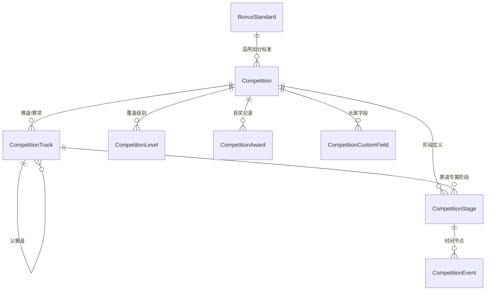

# 竞赛数据模型 V2 设计（Competition 重构）

> 状态：**设计稿，未落地**。本文只做设计，不改动 `apps/api/prisma/schema.prisma`。
> 关联：[DATA_MODEL.md](./DATA_MODEL.md)、[FIELDS.md](./FIELDS.md)、[MODULE_CRAWLER.md](./MODULE_CRAWLER.md)
> 背景：当前 `Competition` 用固定字段 + 枚举表达赛程与结构，无法覆盖「校赛→省赛→国赛」与「预选赛→区域赛→全国赛」并存、以及多赛道/多赛项的巨大差异。

---

## 1. 设计目标

| 目标 | 说明 |
|---|---|
| **阶段链可变** | 不同比赛的赛程层级不同：`校赛→省赛→国赛`、`预选赛→区域赛→全国赛`、`网络赛→现场赛`、`Stage I→Grand Jamboree`……阶段链必须是**数据**，不是枚举 |
| **赛道/赛项可变** | 一个赛事可含多个赛道（如中国高校计算机大赛 5 个子赛），赛道下还可再分赛项（机械工程创新创意大赛：3 赛道 19 赛项） |
| **时间点挂在阶段上** | 一个阶段可有多个时间点（报名开始/截止、提交、比赛、结果公布），且**各赛道日期常常不同** |
| **级别 ≠ 阶段** | 「区域赛」不是「省级」；推免认定看的是奖项级别（国家级/省级），与赛程阶段是两个维度 |
| **长尾可扩展** | 无法穷举的差异（QQ 群号、赛区名、特殊规则）走自定义字段/文本，不污染主表 |
| **人工维护优先** | 所有结构可手工录入；不依赖采集，但为将来采集预留 `isAuto/isLocked` 与来源字段 |

### 核心原则

> **把「会变的维度」（阶段链、赛道、时间点）建成数据行；把「稳定的维度」（赛制、级别、加分）保留为字段。**

---

## 2. 概念模型

```
Competition（赛事主档 · 每届一行）
   │
   ├── CompetitionTrack（赛道/赛项，树形，可空=无赛道）
   │        └── CompetitionTrack（子赛项，自引用）
   │
   ├── CompetitionStage（赛程阶段定义，数据驱动的链）
   │        ├── trackId = null  → 全赛事共享阶段（如"报名"）
   │        └── trackId = X     → 该赛道专属阶段
   │             │
   │             └── CompetitionEvent（时间节点：报名/提交/比赛/结果）
   │
   ├── CompetitionLevel（覆盖级别，多值：国际/国家/省/校）
   ├── CompetitionAward（获奖记录，赛事级）
   ├── CompetitionCustomField（长尾键值）
   └── BonusStandard（引用：推免加分标准）

BonusStandard（加分标准，按认定文件/届次）
```

**关系图（mermaid）**



**一句话**：`Track`（在哪条赛道） × `Stage`（走到哪一层） → `Event`（具体哪天）。三个维度正交，任意组合都能表达。

---

## 3. 表结构设计（Prisma 风格）

### 3.1 Competition（赛事主档）

```prisma
model Competition {
  id          String  @id @default(cuid())
  /// 稳定业务编码，串联 PDF 清单 / 采集源 / 种子数据，替代靠名称字符串对齐
  code        String  @unique          // 如 "CUMCM" / "C4-BIGDATA"
  name        String
  shortName   String?
  aliases     String[]
  year        Int                       // 届次（年度），唯一性 = code + year

  organizer   String?
  officialUrl String?
  sourceUrl   String?

  /// 赛事级默认赛制（无赛道的赛事用这里；有赛道时由 Track 覆盖）
  format      CompetitionFormat?        // INDIVIDUAL / TEAM
  teamSizeMin Int?
  teamSizeMax Int?
  audience    Audience?
  intro       String?  @db.Text
  difficulty  Int?
  effort      Int?

  /// 结构开关（派生/缓存，便于列表快速筛选，可重算）
  hasTracks   Boolean @default(false)
  stageChain  String?                   // 缓存展示用："校赛→省赛→国赛"

  /// 推免加分
  isBonusEligible Boolean?
  bonusStandardId String?               // 引用 BonusStandard
  bonusSpecialRule String? @db.Text     // 特殊规则文本（如美赛 Outstanding 映射）

  status      PublishStatus @default(PUBLISHED)
  createdAt   DateTime @default(now())
  updatedAt   DateTime @updatedAt

  tracks      CompetitionTrack[]
  stages      CompetitionStage[]
  events      CompetitionEvent[]
  levels      CompetitionLevel[]
  awards      CompetitionAward[]
  customFields CompetitionCustomField[]
  bonusStandard BonusStandard? @relation(fields: [bonusStandardId], references: [id])

  @@unique([code, year])
  @@index([status])
  @@index([year])
  @@index([updatedAt])
}
```

> 相比现状新增：`code`（稳定标识，解决四份清单断链）、`hasTracks`、`stageChain`（展示缓存）、`bonusStandardId`、`bonusSpecialRule`。

### 3.2 CompetitionTrack（赛道 / 赛项）

```prisma
/// 赛道/赛项。顶层=赛道，子层=赛项；无赛道的赛事此表为空。
model CompetitionTrack {
  id            String  @id @default(cuid())
  competitionId String
  parentId      String?                 // 自引用：赛道下的赛项
  code          String                  // 赛道编码，如 "BIGDATA" / "FINGERPRINT"
  name          String                  // 大数据挑战赛 / 芯片应用赛道
  shortName     String?
  aliases       String[]
  description   String? @db.Text
  sortOrder     Int     @default(0)
  isActive      Boolean @default(true)

  /// 赛制下沉到赛道级（决策 5）：不同赛道可"个人/团队""人数区间"不同；留空回落到赛事级
  format        CompetitionFormat?
  teamSizeMin   Int?
  teamSizeMax   Int?

  competition Competition       @relation(fields: [competitionId], references: [id], onDelete: Cascade)
  parent      CompetitionTrack? @relation("TrackTree", fields: [parentId], references: [id])
  children    CompetitionTrack[] @relation("TrackTree")
  stages      CompetitionStage[]
  awards      CompetitionAward[]

  @@unique([competitionId, code])
  @@index([competitionId, sortOrder])
  @@index([parentId])
}
```

### 3.3 CompetitionStage（赛程阶段定义）

```prisma
/// 赛程阶段。某赛事的阶段链 = 该赛事下按 sequence 排序的一组 Stage 行。
/// trackId = null → 全赛事共享（如"报名"）；否则为该赛道专属。
model CompetitionStage {
  id            String  @id @default(cuid())
  competitionId String
  trackId       String?                 // null = 全赛事共享阶段
  code          String                  // "CAMPUS" / "PROVINCIAL" / "REGIONAL"
  name          String                  // 展示名："校赛" / "省赛" / "西南赛区" / "全国总决赛"
  stageKind     StageKind               // 语义类型（见枚举）
  scope         String?                 // 赛区/省份限定："西南赛区" / "四川省"
  sequence      Int                     // 链内顺序（1,2,3...）
  /// 推免认定口径：该阶段奖项折算到哪一档（与 stageKind 解耦）
  bonusTier     BonusTier?              // NATIONAL / PROVINCIAL / NONE
  note          String?  @db.Text

  competition Competition        @relation(fields: [competitionId], references: [id], onDelete: Cascade)
  track       CompetitionTrack?  @relation(fields: [trackId], references: [id], onDelete: Cascade)
  events      CompetitionEvent[]
  awards      CompetitionAward[]

  @@unique([competitionId, trackId, code])
  @@index([competitionId, sequence])
  @@index([trackId])
}
```

### 3.4 CompetitionEvent（时间节点）

```prisma
/// 挂在 Stage 上的具体时间点。一个阶段可有多个节点。
model CompetitionEvent {
  id            String  @id @default(cuid())
  competitionId String
  stageId       String
  trackId       String?                 // 冗余自 Stage，便于按赛道过滤
  nodeType      EventNodeType           // 报名开始/截止、提交、比赛、结果…
  label         String?                 // 自定义文案（覆盖默认名）
  startAt       DateTime?
  endAt         DateTime?
  location      String?                 // 承办地/线上
  isAuto        Boolean @default(false) // 预留给将来采集
  isLocked      Boolean @default(false) // 人工锁定，采集不得覆盖
  sourceUrl     String?
  note          String? @db.Text

  competition Competition      @relation(fields: [competitionId], references: [id], onDelete: Cascade)
  stage       CompetitionStage @relation(fields: [stageId], references: [id], onDelete: Cascade)

  @@index([competitionId, startAt])
  @@index([stageId])
  @@index([endAt])
}
```

### 3.5 其余表

```prisma
/// 覆盖级别（保留现状，多值）
model CompetitionLevel {
  competitionId String
  level         Level
  @@id([competitionId, level])
}

/// 获奖记录（决策 2：不挂赛道/阶段，保持赛事级）
model CompetitionAward {
  id            String  @id @default(cuid())
  competitionId String
  year          Int?
  awardName     String?
  awardTier     BonusTier?              // 国家级/省级/…
  teamName      String?
  members       String[]
  sourceUrl     String?
}

/// 加分标准（按认定文件/届次），替代对所有竞赛写死同一句 bonusPoints
model BonusStandard {
  id          String  @id @default(cuid())
  /// 认定文件标识，如 "校教〔2026〕39号-2027届"
  documentRef String
  category    String                    // 学科竞赛 / 文体竞赛
  level       BonusTier                 // NATIONAL / PROVINCIAL
  topPoints    String                   // 最高奖
  secondPoints String                   // 次高奖
  thirdPoints  String                   // 次次高奖
  note        String?  @db.Text
  competitions Competition[]
  @@unique([documentRef, category, level])
}

/// 长尾键值（保留现状）
model CompetitionCustomField {
  id            String  @id @default(cuid())
  competitionId String
  key           String
  value         String  @db.Text
  updatedById   String?
  @@unique([competitionId, key])
}
```

---

## 4. 枚举

```prisma
enum CompetitionFormat { INDIVIDUAL  TEAM }   // 赛制下沉到 Track 级，不再需要 MIXED

/// 阶段语义类型：覆盖"校赛→省赛→国赛"与"预选赛→区域赛→全国赛"等所有常见链
enum StageKind {
  CAMPUS        // 校内赛 / 校赛
  QUALIFIER     // 预选赛 / 资格赛 / 网络赛
  REGIONAL      // 区域赛 / 赛区赛 / 分区赛
  PROVINCIAL    // 省级赛 / 省赛
  NATIONAL      // 全国赛 / 国赛
  INTERNATIONAL // 国际赛
  FINAL         // 总决赛 / 终审决赛
  OTHER
}

/// 时间节点类型
enum EventNodeType {
  SIGNUP_START   // 报名开始
  SIGNUP_END     // 报名截止
  SUBMISSION     // 作品/材料提交
  CONTEST        // 比赛 / 答辩
  RESULT         // 结果公布
  AWARD          // 颁奖
  OTHER
}

/// 推免认定档次（与 Level 区分：Level 是赛事级别展示，BonusTier 是加分折算）
enum BonusTier { NATIONAL  PROVINCIAL  NONE }
```

> **关键设计**：`stageKind`（赛程走到哪层）与 `bonusTier`（加分算哪档）**分离**。因为「区域赛」既不是国家级也不是省级，但它上面的「全国总决赛」折算国家级——两者不能混为一谈。

---

## 5. 用具体竞赛验证

### 5.1 全国大学生数学建模竞赛（无赛道，最简链）
```
Competition(code=CUMCM, year=2026, hasTracks=false, stageChain="报名→竞赛→评奖")
Stage: 报名(CAMPUS, seq1) → 竞赛(NATIONAL, seq2) → 评奖(NATIONAL, seq3)
Event: 报名开始 2026-06-01 / 报名截止 2026-09-03 / 竞赛 2026-09-10~13 / 结果 2026-11
```

### 5.2 "挑战杯"课外学术科技作品竞赛（校赛→省赛→国赛）
```
Competition(code=TZB-ACADEMIC, year=2025, stageChain="校赛→省赛→全国终审决赛")
Stage: 校赛(CAMPUS,seq1) → 省赛(PROVINCIAL,seq2,bonusTier=PROVINCIAL) → 终审决赛(FINAL,seq3,bonusTier=NATIONAL)
```

### 5.3 全国大学生电子设计竞赛（校赛→赛区测评→全国，两年一届）
```
Stage: 校内选拔(CAMPUS) → 赛区测评(REGIONAL, scope=null) → 全国集中竞赛(NATIONAL, bonusTier=NATIONAL)
```
> 「赛区测评」用 `REGIONAL`，不硬套成"省级"——这正是旧模型表达不了的地方。

### 5.4 中国高校计算机大赛（5 赛道，各自独立赛程）
```
Competition(code=C4, year=2026, hasTracks=true)
Track: 大数据挑战赛 / 团体程序设计天梯赛 / 移动应用创新赛 / 网络技术挑战赛 / 人工智能创意赛
各 Track 下各自的 Stage 链：
  天梯赛：报名→初赛→决赛
  大数据：报名→线上赛→现场答辩
```
> 报名日期各赛道不同 → **必须建 per-track Stage**（不能共享）。

### 5.5 中国大学生机械工程创新创意大赛（3 赛道 19 赛项，两层树）
```
Track(智能制造赛) ├─ Track(各赛项…)
Track(材料成型赛) ├─ Track(…)
Track(创新设计赛) └─ Track(…)
共享 Stage: 报名(trackId=null, isShared)   // 全校统一报名
各赛项 Stage: 决赛(trackId=各赛项)        // 时间各异
```

### 5.6 "外研社·国才杯"（5 赛项 × 三级链）
```
Track: 英语演讲 / 英语辩论 / 英语写作 / 英语阅读 / 英语综合能力
每个 Track 下：校赛(CAMPUS)→省赛(PROVINCIAL)→全国决赛(FINAL, bonusTier=NATIONAL)
```

### 5.7 中国国际大学生创新大赛（4 赛道 × 三级链）
```
Track: 高教主赛道 / "青年红色筑梦之旅"赛道 / 产业命题赛道 / 萌芽赛道
Stage(共享): 校级初赛(CAMPUS) → 省级复赛(PROVINCIAL) → 全国总决赛(FINAL, NATIONAL)
```

### 5.8 iGEM（无校赛省赛，国际赛程）
```
Stage: 注册(QUALIFIER) → 评审/提交(SUBMISSION) → Grand Jamboree(FINAL, bonusTier=NATIONAL?)
Event: Grand Jamboree 2026-11-13~16（巴黎）
```

### 5.9 华语辩论世界杯（无校赛，分区赛→总决赛）
```
Stage: 分区赛(REGIONAL, seq1) → 总决赛(FINAL, seq2)
```

### 5.10 全国大学生智能汽车竞赛（多赛道 + 室内/室外分开）
```
Track: 竞速组 / 创意组 / 室外组 …
Stage: 分赛区赛(REGIONAL) → 室内总决赛(FINAL, location=安徽大学) / 室外总决赛(FINAL, 2026-12)
```
> 同一 `stageKind=FINAL` 用不同 `scope`/`location` 表达两个并行决赛。

---

## 6. 与现状的对照

| 现状 | 问题 | V2 方案 |
|---|---|---|
| `CompetitionTimeline.stage`（自由字符串） | 词表不统一、无法排序、无级别 | `CompetitionStage`（stageKind + sequence + bonusTier） |
| 无法表达赛道 | 多赛道赛事只能挤成一条超长名称 | `CompetitionTrack`（树形，可空） |
| `CompetitionLevel` 只有 4 档 | "区域赛"无处安放 | 新增 `stageKind`，与 `Level`/`BonusTier` 解耦 |
| `bonusPoints` 全赛同一句 | 无法表达学科/文体差异与特殊规则 | `BonusStandard` + `bonusSpecialRule` |
| 四份清单靠名称对齐 | 改名即断链 | `Competition.code` 稳定编码 |
| 时间点与阶段混在一行 | 一个阶段多节点表达不了 | `CompetitionStage` → `CompetitionEvent` |

---

## 7. 人工维护下的录入约定（不改动代码，仅约定）

1. **一个赛事一个 `code`**，跨年沿用同一 `code`，用 `year` 区分届次。
2. **无赛道的赛事**：`CompetitionTrack` 不建行，所有 `Stage.trackId = null`。
3. **阶段链排序**：`sequence` 从 1 递增，前端按此渲染"赛程路线图"。
4. **共享 vs 专属判断**：若某阶段各赛道时间/形式相同 → 建一条共享 Stage；不同 → 每个赛道各建一条。
5. **赛区**：同一阶段有多个赛区时，用 `scope` 区分（只录成电相关赛区，或全部列出）。
6. **加分档次**：`bonusTier` 只填 `NATIONAL`/`PROVINCIAL`/`NONE`，严格对齐认定文件。

---

## 8. 决策记录（已确认）

| # | 议题 | 决策 | 对设计的影响 |
|---|---|---|---|
| 1 | 赛区是否独立成表 | **不需要** | `Stage.scope` 保持为字符串，不建 `Region` 表 |
| 2 | 获奖记录是否挂赛道 | **不需要** | `CompetitionAward` 去掉 `trackId`/`stageId`，保持赛事级 |
| 3 | `hasTracks`/`stageChain` 是否落库 | **落库** | 两字段保留在 `Competition` 上，另提供重算脚本 |
| 4 | `code` 编码规则 | **采纳并冻结** | 规则：`组织方/赛事通用缩写-可选子项`，见 §9 |
| 5 | 是否需要 `CompetitionFormat.MIXED` | **不需要；赛制下沉到赛道级** | `format`/`teamSizeMin`/`teamSizeMax` 移到 `CompetitionTrack`，赛事级仅作兜底 |
| 6 | 旧 `CompetitionTimeline` 是否双写过渡 | **否** | 一次性迁移直接切换，不做双写 |

---

## 9. `code` 编码规则（冻结）

- 格式：`<赛事缩写>` 或 `<赛事缩写>-<子赛道缩写>`，全大写 ASCII，连字符分隔。
- 赛事缩写取国际/行业通用简称；无通用简称的取拼音首字母或官方英文缩写。
- 跨年**沿用同一 `code`**，届次用 `year` 区分；赛道 `code` 只在赛事内唯一。
- 示例：`CUMCM`（数模）、`MCM`（美赛）、`NUEDC`（电赛）、`TZB-ACADEMIC`、`TZB-BUSINESS`、`C4`、`C4-BIGDATA`、`ICPC`、`IGEM`、`HUACAN`。
- 完整编码见 [COMPETITION_INSTANCES_V2.md](./COMPETITION_INSTANCES_V2.md)。
